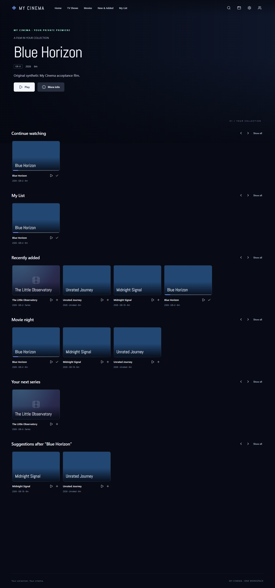

# My Cinema

Your movies, series and family profiles in your own private cinema.

Browse a cinematic home screen, save titles to My List, find a film, choose an
episode and pick up where you left off. Kids get their own rating restrictions
and viewing history. Adult profiles use a PIN.

Open My Cinema from One Workspace and continue with your OneAccount, provided by
MyAccounts. The Workspace owner can connect Movies and TV Shows folders in
Settings. Use the same folders as My Drive to avoid copying videos.

For the portable Windows app, extract the complete release folder and open
`MyCinema.exe`. Its private media engine is included. You do not need Docker,
Node or a separate Jellyfin installation.

- [Get started and recover a backup](docs/SETUP.md)
- [Features and supported devices](docs/SUPPORT.md)
- [Developer build and architecture](docs/DEVELOPMENT.md)
- [Security and compatibility checks](docs/SECURITY-CHECKS.md)
- [Third-party software](THIRD-PARTY-LICENSES.txt)

This is a functional preview. The feature matrix lists the remaining extended
features and verification limits.
